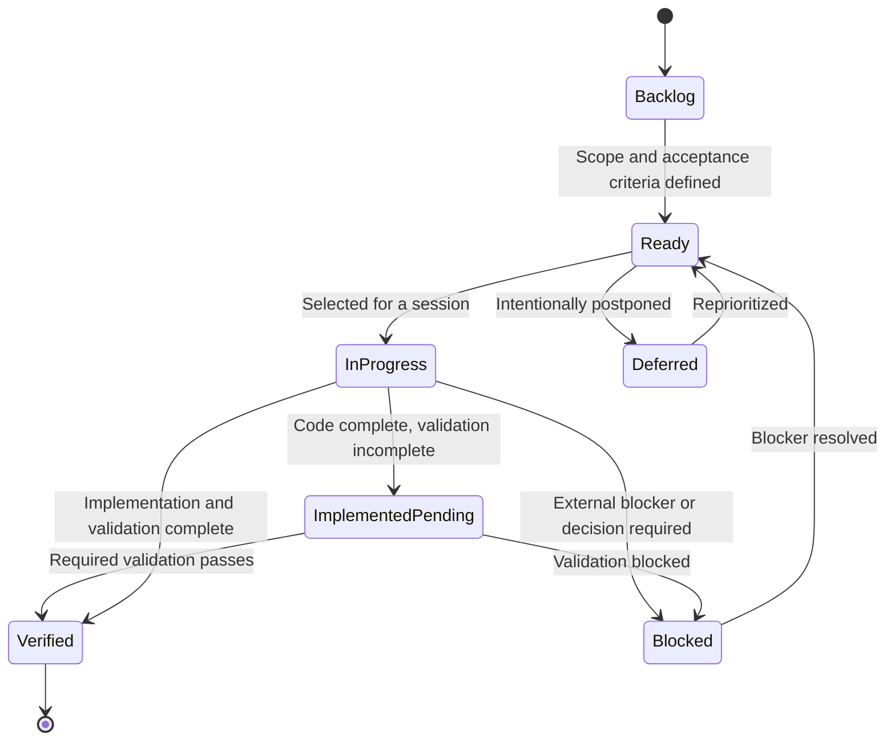

# Iterative GitHub Copilot Workflow

## Purpose

Use GitHub Copilot Agent to enhance the Dictation application incrementally: one well-defined task per session, followed by implementation, testing, validation, and a durable status update.

The repository is the source of truth. Do not rely on previous Copilot chat/session memory to determine what has been completed.

## Repository layout

```text
specs/
├── architecture/
├── wireframes/
├── review/
│   └── current-implementation-review.md
└── implementation/
    ├── README.md
    ├── backlog.md
    └── execution-log.md
```

Keep the review report as the baseline assessment. Track execution status in `backlog.md`, and append session outcomes to `execution-log.md`.

## Operating rules

1. Work on exactly one task per Copilot session.
2. Select only a `Ready` task whose dependencies are `Verified`.
3. At most one task may be `In Progress` at a time.
4. Do not silently take a second task after completing one. Stop and report completion.
5. Before coding, inspect the relevant source, tests, functional requirements, architecture documents, and wireframes.
6. Implement the smallest complete vertical slice that satisfies the task's acceptance criteria.
7. Do not combine unrelated cleanup, refactoring, or enhancements with the task.
8. Preserve existing working Whisper and Groq functionality.
9. Run focused tests first, then relevant regression tests and device validation.
10. Update the backlog and execution log in the same session, based on actual evidence.
11. Never mark a task `Verified` unless its acceptance criteria and required validation have passed.
12. If device validation or another required check cannot be performed, leave the task `Implemented — Validation Pending` and document what remains.
13. If blocked by a missing decision, dependency, environment, or external issue, set `Blocked`, explain the blocker, and do not pick another task in that session unless explicitly instructed.
14. Do not commit, push, create a pull request, or discard user changes unless explicitly asked.
15. Stop after one task and provide a concise handoff for the next session.

## Task lifecycle



Allowed statuses:

| Status | Meaning |
|---|---|
| `Backlog` | Candidate work not yet sufficiently refined |
| `Ready` | Small, actionable task with dependencies satisfied and acceptance criteria defined |
| `In Progress` | The one task currently being implemented or investigated |
| `Implemented — Validation Pending` | Code is implemented but one or more required validations remain |
| `Verified` | Acceptance criteria and required validation have passed |
| `Blocked` | Cannot proceed without an external dependency, environment, or decision |
| `Deferred` | Intentionally postponed |

## Task sizing

A task should be a single cohesive outcome with observable acceptance criteria. Prefer vertical slices that include the relevant UI, application/native behaviour, and tests where appropriate.

Split tasks that:
- Touch multiple unrelated user journeys.
- Introduce several independent architectural boundaries.
- Have too many acceptance criteria to validate together.
- Depend on multiple unresolved technical decisions.
- Cannot be tested independently.

Do not split so aggressively that a task becomes a meaningless one-line change.

## Task selection policy

At the beginning of each session:

1. Read `AGENTS.md` and any applicable nested agent instructions.
2. Inspect `git status`, current branch, and recent relevant changes.
3. Read this workflow and `backlog.md`.
4. Check whether a task is already `In Progress` or `Implemented — Validation Pending`.
5. If a previous task is unfinished, resume that task; do not start another.
6. Otherwise select one `Ready` task:
   - Highest priority first (`P0`, then `P1`, then `P2`).
   - All dependencies must be `Verified`.
   - If tasks have equal priority, follow the explicit order in the backlog.
7. If no task is Ready, report why and stop. Do not invent or expand scope.

If the user explicitly names a task ID, work only on that task and verify that it is eligible. Do not switch to a different task if it is blocked.

## Definition of Done

A task can be marked `Verified` only when:

- All acceptance criteria are satisfied.
- The relevant implementation path has been inspected.
- Required automated tests have passed.
- Relevant build/lint checks have passed where applicable.
- Device/manual validation has passed where required by the task.
- No known regression introduced by the change remains unresolved.
- Documentation/specification updates required by the task are complete.
- The backlog entry and execution log have been updated with evidence.

A successful build alone does not make a feature Verified.

## Status update requirements

Each task entry in `backlog.md` must show:
- Current status.
- Priority.
- Dependencies.
- Requirement/specification references.
- Scope and exclusions.
- Acceptance criteria.
- Validation plan.
- Outcome/evidence.
- Files changed.
- Remaining risks or follow-up work.

Append a dated entry to `execution-log.md` at the end of each session. Never overwrite previous execution history.

## Handling incomplete sessions

If a session ends while a task is `In Progress`:
- Keep it `In Progress`.
- Record what changed, what remains, and the last known test results.
- In the next session, inspect the working tree and resume the same task.
- Do not select another task until the current task is Verified, explicitly Deferred, or formally Blocked and the user authorizes moving on.

If code is complete but validation has not run or has not passed, use `Implemented — Validation Pending`.

## Review and approval gates

- The initial implementation review creates/refines the candidate backlog; it does not implement tasks.
- Tasks with unresolved product/architecture decisions remain `Backlog` or `Blocked`.
- Do not silently alter functional requirements or wireframes to make an implementation appear complete.
- The user reviews the diff and the task result after each session.
- The user decides when to begin the next task.
