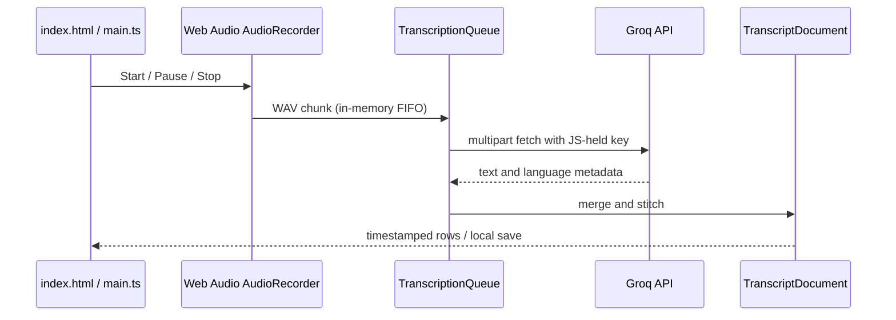

# Dictation App: Current Implementation Review

**Review date:** 2026-11-17  
**Repository:** `sarang-manohar/stt`  
**Branch / commit:** `master` / `8f004ad` (2026-11-15)  
**Scope:** Read-only comparison of the current code with the newer functional, architecture, and wireframe specifications. This report is the only file created for this review.

## 1. Executive summary

The repository is a small, framework-free TypeScript/Vite application that runs as a browser PWA and inside a Capacitor Android WebView. It already has substantial working dictation infrastructure: 16 kHz PCM capture, overlapping WAV chunks, a sequential transcription queue with retry handling, transcript stitching and timestamped JSON, browser-side Groq requests, and an Android JNI/whisper.cpp offline path with a verified model downloader.

The largest gap is not absence of transcription features, but a mismatch in how the active engine is chosen and where responsibilities live:

- The home screen has no explicit `Online (Groq)` / `Offline (Whisper)` selector. The implementation uses connectivity as the routing decision. This can move queued audio from local Whisper to Groq after reconnection without an explicit user mode choice.
- Groq requests and the API key are handled in JavaScript. The key is persisted in browser `localStorage`; a browser build may also embed a configured key. Android builds suppress the build-time key, but the fallback key still resides in WebView storage.
- The Web Audio recorder runs in the web layer. Offline WAV chunks are Base64-encoded and transferred through the Capacitor bridge to native Whisper; Groq chunks are uploaded directly from the web layer.
- The wireframe's six-screen navigation and engine-specific setup/readiness states are represented by a single dictation screen, one transcription-settings dialog, and a separate first-use Groq key dialog.
- Model downloads are size/hash verified before atomic installation and rechecked for status, but the UI has no actual progress/cancel states. The native inference entry point checks model size rather than rechecking its digest.

**Review status count:** 27 reviewer-assigned requirements: 1 Implemented, 19 Partially implemented, 4 Missing, 3 Conflict, 0 Unclear. No requirement was marked Implemented based solely on a screen control or class name.

**Top priorities:** choose explicit engine and privacy/routing behavior; decide the key-storage contract for both Android and browser deployments; prevent queued audio from changing destination implicitly; then move Android capture/transcription orchestration behind a typed native boundary and implement the screen/readiness states. Existing audio slicing, queue, transcript and downloader behavior are valuable reuse points.

## 2. Repository and review context

- Worktree was already dirty before the review: `.gitignore` and `AGENTS.md` were modified; `.github/prompts/` and `specs/` were untracked. These were preserved and not edited by this review.
- The branch was `master`, at `8f004ad` dated 2026-11-15.
- No applicable nested `AGENTS.md` was found.
- No review date/version or explicit precedence is stated in the current functional or architecture documents. The functional design is the most specific product/UI and workflow reference; `key_design_decisions.md` states high-level UI drivers; architecture documents describe a target, not proof of implementation.
- **Legacy document exclusion:** per the user’s clarification, `PRD.md` is from an older implementation. It was not used as a current requirements source, acceptance basis, or source of review statuses. Any old PRD-specific behavior must not be inferred as a current requirement.

## 3. Current-state architecture and source map

### Technology and entry points

- **Web:** static `index.html`, CSS, TypeScript modules, Vite build; no UI framework. `src/main.ts` is the application entry point and owns most UI event wiring and mutable runtime state.
- **Android:** Capacitor `BridgeActivity` with a registered `DictationDevice` plugin. The WebView loads bundled assets; Android app code is Java, and Whisper JNI is C++.
- **Browser deployment:** PWA/service worker and Web Audio. Offline app-shell availability is distinct from offline transcription; browser transcription is not local Whisper.
- **Tests/build:** Vitest unit tests, Playwright browser smoke script, Gradle Android unit tests, Vite/TypeScript builds. The Android CI workflow builds CPU and Vulkan APK variants; unit tests run in its CPU job.

| Area | Current implementation and evidence |
|---|---|
| UI / state | `index.html`, `src/main.ts`, `src/style.css`. Mutable state includes `online`, `modelReady`, `recording`, `paused`, `transitioning`, and queue-derived state. There is no centralized application store or active-engine field. |
| Audio capture | `src/audioRecorder.ts`: `getUserMedia`, `AudioContext`, AudioWorklet with ScriptProcessor fallback, resampling, PCM ring buffer, wake lock, pause/stop flush. Capture runs in JavaScript/Web Audio, including in the Android WebView. |
| Queue / Groq | `src/transcriptionQueue.ts`: FIFO chunk queue, multipart request to Groq, timeout and retry/backoff, language/model selection, local retry path. Groq `fetch` is called directly from this module. |
| Web/native boundary | `src/deviceServices.ts` defines a typed Capacitor plugin shape. Native operations are connectivity status/events, notes load/save, model status/download, and transcription. Offline WAV data is Base64 encoded in JavaScript and passed to `transcribe`. |
| Native Android | `android/app/src/main/java/app/personaldictation/mobile/DictationDevicePlugin.java`: connectivity, local JSON notes, model lifecycle and transcription. `MainActivity.java` registers plugins and keeps the foreground window awake. No Android recording service/controller is present in the inspected app source. |
| Whisper | `android/app/src/main/cpp/whisper-jni.cpp`, CMake and pinned whisper.cpp source prepared by script. JNI loads CPU and optional Vulkan backends, caches the Whisper context, and returns text/language/backend metadata. |
| Model download | `ModelDownloader.java`: HTTPS redirect validation, size and SHA-256 checking, temporary file, fsync, then rename. Android tests cover digest, redirects, invalid content and HTTP errors. |
| Transcript | `src/transcriptDocument.ts`, `src/transcriptStitcher.ts`, `src/transcriptView.ts`, `src/exportTranscript.ts`: shared timestamp-keyed transcript, overlap handling, safe text rendering, copy/share/clear. Browser notes use `localStorage`; Android notes use one app-private JSON file. |
| Activity Trail | `src/activityLog.ts` and `index.html`: structured current-tab events, bounded to 200 display rows, optional configured POST endpoint. It is not a persisted session-history store and has no visible session count. |
| Credentials/preferences | `src/main.ts`: Groq key and language/model preferences use `localStorage`; build-time key is provided through Vite for non-Android builds. The Android build defines the build-time key as empty, but the fallback key remains in WebView storage. |

### Current end-to-end flows

**Current Online route (browser or Android WebView):**

**Current Android Offline route:** the same Web Audio recorder and queue produce chunks. Connectivity is checked to route an item locally; JavaScript converts WAV bytes to Base64, calls `DictationDevice.transcribe`, native Java decodes the payload and invokes the JNI Whisper runtime, and the result returns to the shared transcript. No model/network work is needed by the JNI inference itself once the model is installed. The selection is inferred from connectivity rather than an explicit user-selected mode.

## 4. Current functional behavior

### Recording and Online (Groq)

The web recorder requests microphone access, resamples to 16 kHz mono PCM, emits 10-second chunks on an 8-second stride, and flushes a remaining tail of at least 0.5 seconds. Audio is WAV-encoded. Pause flushes and closes the recorder; Continue creates a fresh capture window. The queue retains its head on errors, retries transient HTTP/network/timeout failures, and pauses for non-retryable failures. Groq requests use `verbose_json`, temperature zero, optional language/model, and up to 200 characters of committed transcript context.

### Offline (Whisper)

On Android, the app checks local model status and permits local transcription when the network is considered offline. The model is a fixed multilingual tiny q5_1 binary. Native JNI inference uses a cached Whisper context, attempts GPU/Vulkan, and has CPU paths. The queue tests verify that offline work does not call Groq and can retain/retry a chunk when the model is missing. These are code/unit-test facts, not device-level confirmation of offline inference quality or backend selection.

The browser PWA does not have the Android model/runtime; it only caches the app shell. The UI currently uses connectivity labels “Online Mode” / “Offline Mode,” which can be mistaken for an explicit mode choice.

### Transcript, settings, and activity

The transcript is timestamp-keyed, stitched across overlaps, editable, and rendered as text rather than HTML. Copy and Share serialize the displayed timestamp/value JSON; Clear resets it. Language/model settings and notes restore locally. A single dialog contains language/model and offline model information; the key dialog appears when a Groq key is needed. The Activity Trail is collapsible and current-tab only.

## 5. Specification inventory and precedence

### Current documents treated as requirements/design references

1. [`specs/functional_design_reference.md`](../functional_design_reference.md) — “Dictation App – UI/UX Implementation Specification”; no explicit version/date. Used as the primary current functional workflow and UI acceptance reference.
2. [`specs/key_design_decisions.md`](../key_design_decisions.md) — high-level UI decisions: visible mode selector, independent readiness, separated settings and privacy transparency; no date/version.
3. [`specs/visualwireframes/implementation_specifications.md`](../visualwireframes/implementation_specifications.md) — screen inventory and wireframe annotations; visual/interaction reference, not implementation proof.
4. [`specs/visualwireframes/visualwireframes.png`](../visualwireframes/visualwireframes.png) — visually inspected six screens and key states.
5. [`specs/architecture/01-architecture-design.md`](../architecture/01-architecture-design.md), [`02-component-and-sequence-diagrams.md`](../architecture/02-component-and-sequence-diagrams.md), [`03-deployment-and-security.md`](../architecture/03-deployment-and-security.md), [`04-copilot-implementation-plan.md`](../architecture/04-copilot-implementation-plan.md), and [`05-native-bridge-contract.md`](../architecture/05-native-bridge-contract.md) — target boundaries, deployment and security, migration sequence, and proposed bridge contract.
6. [`specs/architecture/00-master-architecture-pack.md`](../architecture/00-master-architecture-pack.md) — combined architecture pack, substantially repeats architecture documents 5–9. Treated as a consolidation, not extra independent requirements.

`PRD.md` is explicitly excluded as legacy per user direction. `README.md` was used only as contextual deployment documentation, not as the current requirements authority.

### Ambiguities and conflicts to resolve

- The functional design calls for an explicit active mode and independent readiness, but does not state whether connectivity loss may automatically change routing. The architecture says not to send audio through an unintended engine; the implementation currently routes by connectivity.
- Architecture proposes native audio capture and native Groq networking to keep audio/key out of JavaScript. Current code uses Web Audio and browser `fetch`. Confirm whether those are firm Android target boundaries or longer-term recommendations, and whether browser PWA behavior remains a supported product.
- Secure key storage is required “appropriate for the deployment environment,” while the architecture specifically recommends Android Keystore-backed storage. A PWA cannot use that Android mechanism. Decide whether Android will use native secure storage while browser retains an explicitly disclosed client-side key, or whether the PWA/direct-to-Groq combination changes.
- The wireframe shows settings navigation, model selection/download, connection testing, key reveal/copy/remove, download progress/cancel, and Activity Trail session count. The functional requirements affirm many of these, but some details (model catalog, progress granularity, history retention) remain untestable or unspecified.
- Architecture diagrams mention Room/SQLite, Kotlin, configuration/session managers and native audio, but label these as target/suggested designs. They are not verified implementation constraints; a staged Java/Capacitor migration is preferable to a rewrite.

## 6. Requirements-to-implementation traceability

Statuses are limited to the requested set. IDs below are reviewer-assigned because the current functional design does not number its requirements. “Validation” states what would prove the target behavior; automated tests do not establish device behavior.

| ID | Requirement / source | Current implementation evidence | Status | Gap / impact / priority | Validation needed |
|---|---|---|---|---|---|
| FR-001 | Explicit, equally discoverable Online/Offline mode selector; functional design §2, key decisions A | `index.html` has connectivity and status labels, no selector; `main.ts` uses `online` state | Missing | Core user choice/readability; P0 | UI test verifies both modes, persistence and setup states |
| FR-002 | Independent engine readiness and active model; functional design §§2–3 | `modelReady` for the one local model; network label and one resolved transcription display | Partially implemented | Readiness is not per selected engine; no active mode; P1 | State/UI tests for ready, setup-required, downloading, error |
| FR-003 | Start, pause/resume, stop, duration and processing states; functional design §2 | `main.ts` recording handlers; `audioRecorder.test.ts`, browser smoke | Partially implemented | Recording controls exist, but status/process state is queue/network inferred and not an explicit lifecycle contract; P1 | Browser interaction tests plus permission/interruption device tests |
| FR-004 | Shared timestamped transcript with Copy, Share, Clear; functional design §§2, 7 | `TranscriptDocument`, `transcriptView`, `exportTranscript`; transcript/export tests | Implemented | Verified for app behavior in code/tests; hardware share destinations still need device checks | Unit/browser tests passed; Android share/manual validation |
| FR-005 | Collapsible Activity Trail, recent sessions and session count; functional design §2 | `
` and bounded current-tab `appendActivity` | Partially implemented | Current-tab events only; no prior session list/count or persistence; P2 | Restart/history tests after product retention rules are defined |
| FR-006 | Dedicated settings sections and navigation; functional design §2, wireframes screens 4–6 | `index.html` has one transcription dialog and separate first-key dialog | Missing | Major wireframe/IA mismatch; P1 | Screen-flow and responsive UI tests |
| FR-007 | Independent mode-specific language/model configuration; functional design §§3–4 | One shared language/model selector persisted by `main.ts`; local model is fixed in Android | Partially implemented | No mode-specific selection, local model selection, or explicit mode restoration; P1 | Switch-and-restart tests prove configuration independence |
| FR-008 | Offline works after model installation without internet or Groq key; functional design §§3–4, §7 | `TranscriptionQueue.localRequest`, native transcribe, `offlineTranscription.test.ts` | Partially implemented | Code path and mocked queue tests support it; actual airplane-mode inference has not been run | Waydroid/target-device test with model installed and no key/network |
| FR-009 | Model status/download progress, cancel, interruption recovery; functional design §2 / Offline settings | `ModelDownloader` hashes and atomically renames; plugin exposes only `ready` and download promise; UI displays a fixed “Downloading and verifying” message | Partially implemented | Integrity/retry-by-redownload exists; no observable progress/cancel; recovery is not device-tested; P1 | Downloader tests plus interrupted/cancel/retry device scenarios |
| FR-010 | Groq key setup, masked saved state, update/remove; functional design §2 Online settings | `key-dialog`, `localStorage`, key form; recovery can reopen input | Partially implemented | No saved masked state, explicit remove, show/hide control; Android storage is WebView localStorage; P0 security | Android secure-store contract tests; UI tests for create/update/remove |
| FR-011 | Test connection and show valid/invalid/connection states; functional design §2 | Queue only discovers errors on transcription; no test-connection command or UI | Missing | Users cannot verify setup before recording; P1 | Mocked API and device connectivity tests |
| FR-012 | Missing-key dialog can dismiss or choose Offline; functional design §2 first-time flow | `key-dialog` has “Not now”; no “Use Offline Instead” action or mode switch | Partially implemented | Dismissal exists, but does not select/configure Offline; FR-001 dependency | UI flow test with no key and local model status |
| FR-013 | Do not start when selected engine is unready; functional design §3 | `record` checks network-derived local model readiness or Groq key | Partially implemented | Guards are tied to connectivity rather than selected mode; model validity can change after startup status check; P1 | Mode-specific readiness transition tests |
| FR-014 | Lock settings/mode changes while recording or queued; functional design §3 | Language/model controls and Clear/Share are disabled while busy | Partially implemented | Relevant controls lock, but mode selection is absent; settings dialog can remain open; P1 | UI and queue-state interaction tests |
| FR-015 | Clear privacy explanation; Offline stays on device, Online goes directly to Groq; functional design §§1, 7 | Settings dialog has privacy text; routing follows connectivity and Groq fetch is web-side | Partially implemented | Copy is present, but not coupled to an explicit mode and does not communicate key-storage limitation fully; P0 | Verify copy against actual mode and destination; network capture on device |
| FR-016 | Actionable Online/Offline errors and recovery; functional design §5 | Queue pauses/retries; model download error string; mic notices and retry control | Partially implemented | Some errors actionable; no connection test, download progress/cancel, standardized error code contract; P1 | Error-state tests and native bridge error mapping |
| FR-017 | Restore active mode, readiness and independent persistent settings; functional design §§3–4 | Notes and language/model preferences restore; model status is checked on Android | Partially implemented | No active mode to restore, no independent configurations or connection status; P1 | Cold-start/restart tests online and offline |
| FR-018 | Responsive Android screens, safe areas and keyboard/scroll behavior; functional design §7 | CSS viewport/safe-area rules; browser smoke checks 393×852, 320×720 and landscape | Partially implemented | Web browser viewports covered; no Waydroid/phone system bars, keyboard or native viewport validation | Device viewport, keyboard, inset and scrolling checks |
| FR-019 | Allowlisted typed bridge, lifecycle, IDs, structured errors, small payloads; bridge contract | Typed `DeviceServices`; plugin methods are explicit; only `networkChanged` event; audio Base64 passed through bridge | Partially implemented | Typed subset exists, but no session/request IDs, standardized error shape, operation progress/cancel, or small-audio boundary; P1 | Contract tests, invalid-input tests, listener lifecycle tests |
| FR-020 | UI uses application/native bridge rather than directly calling engine/network implementations; architecture §§1, 3–4 | Groq request is `fetch` inside `src/transcriptionQueue.ts`; offline inference is via plugin | Conflict | Current direct JS Groq/audio boundary differs from target architecture; resolve P0/P1 boundary decision | Integration test confirms intended request origin and data path |
| FR-021 | Shared native audio capture and audio remains native; architecture §§1–3, bridge §data | `AudioRecorder` uses Web Audio; offline chunk Base64-encoded in `deviceServices.ts` | Conflict | Target says native capture/no large bridge audio; current architecture is web capture; security, memory and lifecycle impact; P1 | Device audio pipeline, pause/stop, payload/memory tests |
| FR-022 | Normalize both engines into shared timestamped transcript segments and persistence; architecture §shared model, functional design §2 | Both return `TranscriptionResult`; `TranscriptDocument` stores timestamp-to-text map | Partially implemented | Shared visible format works, but lacks session/engine/segment IDs and engine metadata per saved segment; P1 | Persistence and export contract tests |
| FR-023 | Model must be integrity-verified before ready and before use; architecture §§Whisper/model storage | Download/status verify SHA-256 and size; `transcribe` checks only file and size before JNI | Partially implemented | Normal install path is strong; inference does not revalidate digest, leaving a changed/corrupt same-size model undetected; P1 | Corrupt same-size file test through model-status and transcribe paths |
| FR-024 | Preserve Vulkan-preferred, CPU fallback; functional design §Offline settings, architecture | JNI loads CPU/Vulkan and retries model init with `use_gpu=false`; build CI has CPU/Vulkan variants | Partially implemented | Code/build paths exist; initialization, fallback and reported backend are not device-verified | Vulkan-capable and CPU-only device tests; verify actual backend |
| FR-025 | Lifecycle/permission interruption and background behavior; functional design §5, architecture §recording strategy | Web `getUserMedia`, wake lock and visibility resume; `MainActivity` keeps foreground screen on; no foreground recording service found | Missing | Background/lock recording cannot be promised; interruption handling is mainly track-ended/visibility; P1 | Permission revoke, rotation/background/lock/return device tests |
| FR-026 | Automated tests and release validation for web, native bridge, engines and device workflows; architecture §test strategy | 83 Vitest tests; browser smoke; 6 Android JUnit tests; Android CI CPU/Vulkan APK builds | Partially implemented | Good utility/queue coverage; little UI/native bridge/inference integration coverage; no device check completed; P1 | Add focused integration tests and complete device matrix |
| FR-027 | Offline must not silently route audio to Groq; functional design §§1, 3 and architecture §constraints | Queue checks current `isOnline()` for each item; on reconnect later queued items take cloud request path | Conflict | Connectivity is not explicit user consent; a queued offline chunk can be sent to Groq after reconnection. Highest privacy/routing risk; P0 | Regression test changing connectivity with queued chunks; confirm destination never changes silently |

## 7. Wireframe alignment

The supplied image was inspected visually, along with its accompanying specification. The board contains six screens (Main Ready, Recording Offline, Online Groq, Settings, Transcription Settings, Online Settings), plus model/key/readiness states.

| Screen / journey | Current alignment |
|---|---|
| Main Ready / Online / Offline | Header, transcript, actions, Start and Activity Trail broadly resemble the minimal visual direction and purple palette. The central segmented mode selector, engine-specific readiness card and model secondary label are absent; connectivity is shown instead. |
| Recording | Pause/Continue and Stop controls and timer are present. No explicit engine badge/state is shown; queue processing can continue in parallel. |
| Settings navigation | The wireframe has a settings container and separate sections. Current implementation uses one modal with language/model and Offline settings; no section list, General or About. |
| Transcription settings | One shared language and Groq model selector exists. No Online/Offline radio/segmented selection or separate local model configuration. |
| Online settings / key | Initial key-entry dialog exists. No separate settings page, masked saved-key display, reveal/copy, remove, connection test, or persisted connection status. |
| Model download states | A download button and static message are present. Actual progress, cancel, loading/validation, and explicit retry states are missing from the UI; errors are presented as text. |
| First-time Offline | Android can prompt through settings when the local model is missing. There is no mode selection step; readiness is inferred from network status. |
| Returning Offline | Android checks model readiness at launch, but no persisted Offline selection exists. Without network, the route becomes local automatically. |
| First-time/returning Online | Missing key prompts for entry, but no connection test/readiness validation or saved masked status. |
| Switching engines | No explicit switching control or workflow. Connectivity changes route queued work. |
| Transcript / Activity Trail | Transcript actions/timestamped rows align functionally. Activity Trail expands/collapses, but it does not display previous sessions or count as shown in the wireframe. |
| Restart/restoration | Notes and language/model settings restore; active engine and per-engine configuration do not exist. |

Responsive CSS and browser smoke testing establish a good web viewport baseline. Android safe areas/system bars, keyboard behavior, dialog scrolling and target-device sizes remain unverified.

## 8. Architecture gap analysis

### Reusable as-is or with thin adapters

- The TypeScript/Vite build and Capacitor container are already present; no new container/framework is needed.
- `SlidingWindowSlicer`, `PcmResampler`, WAV encoding, queue ordering/retry, transcript stitching, timestamped display/export and safe text rendering have meaningful tests.
- Native Whisper JNI/runtime, pinned model identity, verified downloader and CPU/Vulkan build configuration should be preserved.
- `DictationDevice` already supplies an explicit Capacitor plugin allowlist and a connectivity event. Extend it rather than introducing arbitrary native invocation.

### Main target/current differences

1. **Orchestration and source of truth:** `main.ts` combines UI, network-derived route, settings, recording state, persistence and queue coordination. Active engine/readiness are not domain state.
2. **Web/native boundary:** capture and Groq are web-side; Offline audio crosses the bridge as Base64. Target architecture puts capture and both engine requests natively and returns small normalized results.
3. **Engine abstraction/configuration:** no common engine interface/manager or independent engine settings; routing is a connectivity branch.
4. **Persistence:** transcript is one JSON snapshot, preferences are browser storage, and no active mode/session history is modeled. This is short of the target separation of transcript/session/configuration/credentials.
5. **Bridge contract:** current plugin is smaller than the proposed contract and does not provide typed recording/model progress events, correlation IDs, lifecycle recovery, or standardized errors.
6. **Model lifecycle:** model validation and atomic installation are a strong base. Status is only boolean, and UI lacks progress/cancel and runtime loading state.
7. **Android lifecycle:** no foreground service is evident. Existing screen-on and browser wake-lock behavior should not be represented as guaranteed background recording.

Do not port the entire target component list as a single rewrite. First lock product decisions, then add boundaries around current working code one vertical slice at a time.

## 9. Security, privacy, reliability and performance risks

Severity is a review prioritization, not a claim of exploitability. No security penetration test was performed.

| Risk | Evidence and impact | Severity | Mitigation / decision |
|---|---|---|---|
| Implicit engine routing can send queued offline audio to Groq after reconnect | Queue decides for each chunk using current connectivity; a later chunk can use `request()` after the network comes back. User may understand “Offline” as a persistent privacy choice. | High / P0 | Make mode explicit and attach the selected engine/destination to each recording/chunk; never change destination without user action. Add transition tests. |
| Groq API key available to JavaScript and browser storage | `main.ts` reads/writes `groq-api-key`; Vite can define a build-time browser key. Any same-origin script/runtime can access it; masking an input does not secure storage. Android only disables build-time injection; fallback remains in WebView storage. | High / P0 | Use native Keystore-backed storage and native Groq requests for Android if approved. Explicitly decide/document the browser PWA tradeoff (client-side key is not secret) without introducing a backend implicitly. |
| Audio crosses the bridge and JS memory for Offline inference | `offlineTranscribe` materializes bytes, Base64 string and plugin payload; Java decodes to WAV bytes. This creates copies of sensitive audio and extra memory/latency. | High / P1 | Native capture or app-private audio handoff; avoid Base64 payloads. Bound audio lifetime and clean up. |
| Android/network connectivity is treated as engine selection | `online` is sourced from `networkStatus` / browser `navigator.onLine`; UI presents that as mode. Captive portals, disconnect/reconnect, or model availability can change routing independently of intent. | High / P0 | Separate selected mode, readiness, and network status in state/UI. |
| Model integrity is not checked at each inference boundary | Startup status and download verify SHA-256, while inference checks only file existence/length. A same-size altered file may pass the inference guard. | Medium / P1 | Reuse the digest validator before loading/inference or bind a verified installed-model state to safe file replacement; add same-size-corruption coverage. |
| Long-running operations lack cancellation/progress and operation IDs | Download runs on a single IO executor, no progress/cancel command; WebView destruction and user retry behavior are not correlated. | Medium / P1 | Add progress/cancel and operation identity to bridge; preserve existing atomic install and error detail. |
| App background/lifecycle capture not proven | Web Audio and wake lock are not a foreground-service guarantee; `MainActivity` screen-on flag only applies while foregrounded. | Medium / P1 | Keep foreground limitation visible unless a separate foreground-service task is approved and device-tested. |
| Transcript/settings saves may fail or be interrupted | Android writes one JSON file; browser uses localStorage; queue/audio are in-memory. Save errors are surfaced but process termination can lose queued audio. | Medium / P1 | Define retention/session recovery requirements, consider atomic native transcript writes, and test process interruption. |
| Offline inference, GPU fallback, permission behavior unverified on target devices | Tests exercise queue/downloader/utilities, not actual JNI inference, microphone permissions, Vulkan driver behavior or lifecycle. | Medium / P1 | Use connected Waydroid/target device validation; distinguish emulator backend from physical hardware. |

No evidence was found in the inspected code that API keys, transcript text, or audio are intentionally written to the Activity Trail. The logger does write structured metadata to the console and optionally to its configured endpoint; keep allowlisted details and avoid adding secrets/transcript contents.

## 10. Tests and validation

Checks actually run:

| Command/check | Result |
|---|---|
| `npm test` | Passed: 10 test files, 83 tests. |
| `npm run test:browser` | Passed, exit code 0. Production TypeScript/Vite build succeeded; both AudioWorklet and ScriptProcessor fallback browser smoke scenarios passed. |
| `cd android && ./gradlew testDebugUnitTest` | `BUILD SUCCESSFUL`; Gradle reported tasks up-to-date. Existing XML reports contain 6 tests total (5 `ModelDownloaderTest`, 1 `ExampleUnitTest`), no failures/errors/skips. |
| Waydroid ADB check | `adb` is installed. `adb connect 127.0.0.1:5555` returned connection refused; `adb devices -l` reported no attached devices. No APK was installed and no device runtime behavior is claimed. |

No Android APK build, connected instrumentation test, live Groq request, airplane-mode inference, permission/lifecycle test, or Vulkan/CPU runtime check was performed for this review. Groq network traffic in the browser smoke is mocked. The unit tests do not establish device behavior.

## 11. Prioritized phased enhancement roadmap

Each phase is an independently reviewable task candidate, not authorization to begin implementation. Preserve the existing queue, Whisper runtime, downloader and transcript code where possible.

### Phase 0 — Resolve mode and credential decisions

- **Priority:** P0; prerequisite for routing/security work.
- **Objective/value:** Define explicit engine semantics and avoid accidental audio destination changes; define support/privacy for browser PWA versus Android.
- **Addresses:** FR-001, FR-007, FR-010, FR-015, FR-027; wireframe Main and Online Settings.
- **Likely areas:** `specs/functional_design_reference.md`, `specs/architecture/01-architecture-design.md`, bridge contract, then `src/main.ts` / `src/transcriptionQueue.ts`.
- **Dependencies:** User/product decisions listed in §12.
- **Implementation notes:** Separate active mode from network state. Freeze destination per queued chunk/session. Android Keystore plus native Groq is consistent with target architecture; browser PWA key handling requires a separately approved disclosure/approach.
- **Acceptance:** Online/Offline selection persists; readiness is shown independently; switching is blocked while recording/queued; connectivity changes do not silently change the destination; Offline never requires a key/network.
- **Validation:** Queue unit tests with offline→online and online→offline transitions; mode/readiness UI tests; airplane-mode test on emulator/device.
- **Risk/rollback:** Data-routing behavior is user-visible and privacy-sensitive. Gate with an explicit mode state and keep prior implementation behind a reviewed transition only if needed; do not silently upload old Offline queue items.

### Phase 1 — Secure Android Groq credential and request boundary

- **Priority:** P0.
- **Objective/value:** Remove Android API key persistence and Groq request handling from WebView JavaScript, consistent with the architecture.
- **Addresses:** FR-010, FR-011, FR-015, FR-019–020.
- **Likely areas:** `src/deviceServices.ts`, `src/transcriptionQueue.ts`, `src/main.ts`, `DictationDevicePlugin.java`, new native credential/client classes and tests.
- **Dependencies:** Phase 0 deployment decision; retain browser behavior only as explicitly approved.
- **Implementation notes:** Add allowlisted save/update/remove/test and transcription commands; store Android credentials with Keystore-backed encryption; return status, never the key. Keep requests direct to Groq if that remains the product decision.
- **Acceptance:** Android no longer stores/retrieves the key in localStorage or bundles it; missing/invalid/connectivity states are actionable; Offline is independent.
- **Validation:** Unit/bridge tests, APK static inspection for test secrets, mocked Groq HTTP tests, Android credential lifecycle test. Do not expose real credentials in tests/logs.
- **Risk/rollback:** Credential migration can strand existing local keys; provide an explicit re-entry path and never silently copy/log the old secret.

### Phase 2 — Native audio and typed operation lifecycle

- **Priority:** P1.
- **Objective/value:** Match the intended audio/native boundary, reduce bridge copies, and make recording/download/transcription lifecycle explicit.
- **Addresses:** FR-003, FR-009, FR-019, FR-021, FR-025.
- **Likely areas:** `src/audioRecorder.ts`, `src/deviceServices.ts`, `DictationDevicePlugin.java`, `MainActivity.java`, Android manifest, bridge tests.
- **Dependencies:** Phase 0; Phase 1 for native Groq flow.
- **Implementation notes:** First determine whether native capture is mandatory for the APK while retaining browser capture for PWA. Reuse 16 kHz WAV/resampling and chunking behavior where compatible. Add typed recording/model/transcription events, operation IDs, cancellation/progress, and structured errors. Do not claim background recording without a foreground-service design and Android validation.
- **Acceptance:** One capture path per deployment; no large Base64 audio payload for native inference; start/pause/resume/stop/interruption preserve queue semantics; native events/listeners are disposed correctly.
- **Validation:** Existing audio tests plus bridge/integration tests; Android microphone permission, lifecycle, pause/stop and memory tests.
- **Risk/rollback:** High regression risk to working capture. Migrate one operation at a time and preserve a known-good browser recorder until native parity is demonstrated.

### Phase 3 — Wireframe-aligned screens and readiness

- **Priority:** P1.
- **Objective/value:** Make engine choice, readiness and configuration discoverable, matching the six-screen reference and required recovery states.
- **Addresses:** FR-001–002, FR-005–007, FR-011–018; all wireframe screens.
- **Likely areas:** `index.html`, `src/main.ts`, `src/style.css`, focused browser tests.
- **Dependencies:** Phase 0; depends on available readiness/connection commands from Phase 1 and model progress from Phase 2 where applicable.
- **Implementation notes:** Build incrementally with existing HTML/CSS rather than introducing a framework. Separate settings sections and engine-specific model configuration; retain transcript and Activity Trail behaviors.
- **Acceptance:** Main selector, per-engine status/model, setup-required states, key/model management actions and dialogs match approved flows; accessibility and safe-area behavior remain intact.
- **Validation:** Playwright flow/state tests across portrait, narrow and landscape sizes; Android viewport, keyboard and safe-area checks.
- **Risk/rollback:** Broad visual change can hide existing useful controls; stage screen navigation after mode/state logic and preserve transcript controls.

### Phase 4 — Model lifecycle hardening and recoverable persistence

- **Priority:** P1.
- **Objective/value:** Complete model progress/cancel/recovery and make installed-model readiness trustworthy; clarify persistence/session behavior.
- **Addresses:** FR-009, FR-017, FR-023, FR-022, FR-005.
- **Likely areas:** `ModelDownloader.java`, `DictationDevicePlugin.java`, `ModelDownloaderTest.java`, transcript persistence modules and Android tests.
- **Dependencies:** Phase 2 bridge lifecycle; decision on supported model catalog and history retention.
- **Implementation notes:** Reuse checksum/atomic installation. Validate content before use, not only file length. Define cleanup and whether session/activity history is a requirement before adding database dependencies.
- **Acceptance:** Progress/cancel/failure/retry are truthful; partial files are never ready; same-size corruption is rejected; transcript saves survive defined interruption cases.
- **Validation:** Downloader failure/cancel/recovery tests, corrupted-model tests, app restart and process-interruption device checks.
- **Risk/rollback:** Model replacement can invalidate an existing working install; preserve the current verified model until the replacement passes validation.

### Phase 5 — Broaden integration and device validation

- **Priority:** P1, then P2 for polish.
- **Objective/value:** Establish evidence for offline/privacy, engine behavior, runtime backend, and deployment.
- **Addresses:** FR-008, FR-018, FR-024–026.
- **Likely areas:** `src/*.test.ts`, Android local/connected tests, `.github/workflows/android.yml`, release/device checklist.
- **Dependencies:** Phases 1–4.
- **Acceptance:** Automated regression tests cover engine routing, queue recovery, bridge contract and persistence; manual matrix covers microphone permission, airplane mode, restart, model recovery and background behavior.
- **Validation:** Run web unit/browser suite, CPU/Vulkan builds and connected Android checks on Waydroid and at least one supported physical device where GPU behavior is claimed.
- **Risk/rollback:** Emulator results do not prove physical Vulkan performance; report backend and device characteristics rather than treating emulator success as universal.

## 12. Open questions and approval decisions

1. Should `Online (Groq)` and `Offline (Whisper)` be explicit persistent modes, with connectivity shown separately? The wireframe and functional state model imply yes; current code routes by connectivity.
2. If the device loses network during an Online session, should the queued audio stay queued for Groq, be discarded with consent, or be transcribed locally only after a prompt? The current automatic offline path and later automatic cloud routing should not be retained without an explicit privacy policy.
3. Is the browser PWA still a supported first-class deployment, or is the target now Android-first? If both are supported, approve distinct credential policies: Android secure native storage versus browser client-side key disclosure/limitations, or another explicit design.
4. Is native audio capture a firm requirement for Android, or may the existing Web Audio path remain temporarily while the engine/credential boundary is migrated?
5. Should Activity Trail mean current runtime diagnostics or persistent prior-session history with session count? Define retention and privacy before adding storage.
6. Is the current tiny q5_1 model the only supported local model, or should the UI expose a model catalog? Wireframe variants must not be shown until implementation/runtime support is verified.
7. Is background/locked-screen recording required? Current README context says not guaranteed; architecture says evaluate a foreground service if needed. This review did not use the legacy PRD to decide.
8. The Waydroid ADB endpoint was refused at `127.0.0.1:5555`. If device validation is desired, provide the reachable ADB host/port or start/attach the emulator so `adb devices` lists it.

## 13. Likely implementation areas

- **Web/UI/state:** `index.html`, `src/main.ts`, `src/style.css`, `src/deviceServices.ts`
- **Audio/queue/engines:** `src/audioRecorder.ts`, `src/transcriptionQueue.ts`, `src/wavEncoder.ts`
- **Transcript/activity:** `src/transcriptDocument.ts`, `src/transcriptStitcher.ts`, `src/transcriptView.ts`, `src/exportTranscript.ts`, `src/activityLog.ts`
- **Android bridge/model:** `android/app/src/main/java/app/personaldictation/mobile/DictationDevicePlugin.java`, `MainActivity.java`, `ModelDownloader.java`, Android manifest, native tests
- **Whisper runtime/build:** `android/app/src/main/cpp/whisper-jni.cpp`, `CMakeLists.txt`, Gradle configuration and Android CI
- **Tests:** current `src/*.test.ts`, browser smoke script, Android JUnit/connected tests
- **Specifications only after decisions:** functional design, relevant architecture and wireframe references. Do not edit generated OpenWiki pages as part of implementation unless the documented maintenance process requires regeneration.

## 14. Review conclusion

The current app has tested, reusable transcription and transcript primitives, but does not yet implement the newer product's explicit engine-selection and per-engine readiness experience. The most important correctness/privacy concern is connectivity-driven routing of queued audio; the most important security gap is the JavaScript-accessible Groq key. Resolve those behaviors before UI polish or structural refactoring. The Waydroid emulator could not be reached through the stated ADB endpoint during this review, so native runtime and device acceptance remain open.
